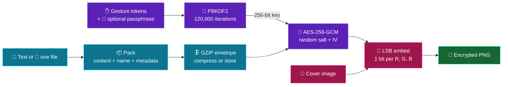
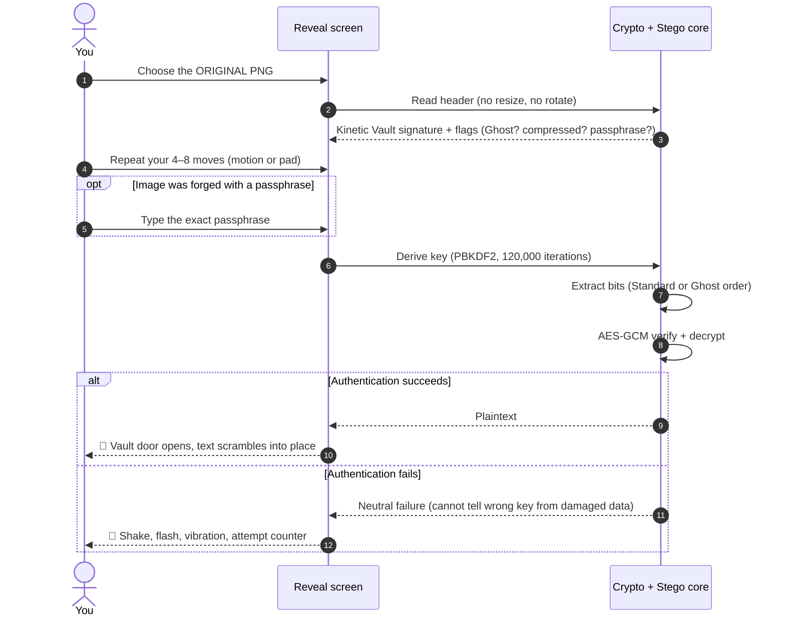
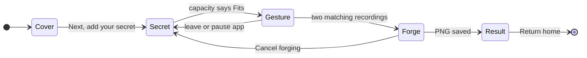
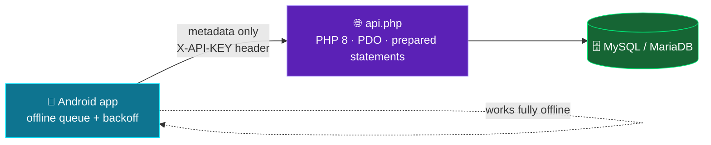
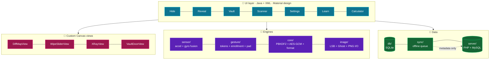

<div align="center">


<a href="https://github.com/SandhuAmy35/Kinetic-Vault">
  
</a>

<br/>


<br/>

**[Quick start](#quick-start)** &nbsp;•&nbsp; **[How it works](#how-it-works)** &nbsp;•&nbsp; **[Gestures](#gesture-engine)** &nbsp;•&nbsp; **[Stego deep dive](#steganography-deep-dive)** &nbsp;•&nbsp; **[Security](#security-model)** &nbsp;•&nbsp; **[Cloud Ledger](#cloud-ledger)** &nbsp;•&nbsp; **[Build](#build-and-run)** &nbsp;•&nbsp; **[Docs](#documentation-map)**

</div>

---

> ### 🧬 In one breath
> **Kinetic Vault** is an Android app that **encrypts text or a file**, **hides the ciphertext inside the pixels of a normal-looking PNG**, and **unlocks it with a repeatable phone-motion gesture** (plus an optional passphrase). Tilt, snap, hold flat. Your hand becomes part of the key.
> It works **fully offline**. A privacy-first **Cloud Ledger** (PHP + MySQL) is optional and receives **metadata only**.

<div align="center">

| 🔐 **Cipher** | 🧮 **Key stretch** | 🖼️ **Pixel change** | 📉 **Quality floor** | ✋ **Gesture** | 📱 **Runs on** |
|:---:|:---:|:---:|:---:|:---:|:---:|
| AES-256-GCM | PBKDF2 · 120,000 iterations | ≤ 1 per R/G/B channel | PSNR ≥ 48.13 dB | 4 – 8 of 6 named moves | Android 8.0+ (minSdk 26) |

</div>

---

<a name="table-of-contents"></a>
## 📚 Contents

<table>
<tr>
<td valign="top">

1. [Why this exists](#why-this-exists)
2. [Quick start](#quick-start)
3. [How it works](#how-it-works)
4. [Feature tour](#feature-tour)
5. [Gesture engine](#gesture-engine)
6. [Steganography deep dive](#steganography-deep-dive)
7. [Visual lab](#visual-lab)

</td>
<td valign="top">

8. [Security model](#security-model)
9. [Vault library and local data](#vault-library-and-local-data)
10. [Cloud Ledger](#cloud-ledger)
11. [Architecture](#architecture)
12. [Build and run](#build-and-run)
13. [Limits cheat sheet](#limits-cheat-sheet)
14. [FAQ and troubleshooting](#faq-and-troubleshooting)

</td>
<td valign="top">

15. [Roadmap and status](#roadmap-and-status)
16. [Concepts showcase](#concepts-showcase)
17. [Team workstreams](#team-workstreams)
18. [Documentation map](#documentation-map)

</td>
</tr>
</table>

---

<a name="why-this-exists"></a>
## 💡 Why this exists

Most "secure" tools shout that they hold a secret: an encrypted blob is obviously an encrypted blob. Most "hidden message" tools whisper but do not protect anything: find the data and you can read it. Kinetic Vault stacks the two ideas and adds a third factor you **do** rather than only know.

| Layer | What it contributes |
|---|---|
| 🔐 **Cryptography** | AES-256-GCM encrypts *and authenticates* your data. Tamper with a single bit and unlock fails. |
| 🖼️ **Steganography** | The ciphertext is spread across the least significant bits of an ordinary PNG. The cover still looks like a photo or artwork. |
| ✋ **Kinetic key** | A short sequence of phone motions is converted into tokens and mixed into the key derivation. |
| 🔑 **Passphrase** | Optional but recommended. Gestures alone carry little entropy (see [the math](#why-a-passphrase-matters)). |

> [!IMPORTANT]
> Each image has **its own** gesture and passphrase. There is no master key, no account, no reset, and no recovery service. Keep an **unchanged copy of the PNG** and remember its credentials.

---

<a name="quick-start"></a>
## 🚀 Quick start

### Hide your first secret (about 3 minutes)

| # | Do this | Why |
|:-:|---|---|
| 1 | Open the app → **Hide a secret** → **Generate a cover** | Creates a fresh 1,024 × 1,024 plasma/gradient/noise cover, entirely offline. |
| 2 | **Next: add your secret** → keep **Text** selected → type a message | A vault holds text *or* one file. |
| 3 | Keep **Compress the secret** on; tick **Add a passphrase (recommended)** | Compression saves space; the passphrase adds real entropy. |
| 4 | Wait for the capacity meter to say **Fits** | Measured against the *actual* packed + encrypted size. |
| 5 | **Next: enroll your gesture** → record **4 – 8 moves** → **Done recording** → record the **same** sequence again | Two matching recordings prove you can repeat it. No motion? Use the on-screen **Gesture Pad**. |
| 6 | **Forge encrypted PNG** and keep the screen open | Watch the matrix rain while the key is derived and bits are embedded. |
| 7 | **Save PNG** (or **Share PNG file** as a *Document/File*) | Photo-style sharing recompresses and destroys the vault. |

### Unlock it

**Reveal a secret** → pick the **original saved PNG** → perform the **same moves** → enter the passphrase → **Unlock vault**. 🚪 The vault door opens and the plaintext scrambles into place.

### 🎬 The 3-minute demo flow

1. Hide a harmless message and show the enrollment orb and matrix rain.
2. Open the result: drag the **before/after wipe**, then the **Diff Map Pro** loupe.
3. Flip **Ghost vs Standard** to see the two placement strategies side by side.
4. Try a **wrong gesture**: the door shakes and flashes red. Then unlock with the right one.

---

<a name="how-it-works"></a>
## ⚙️ How it works

### The Hide pipeline



### The Reveal handshake



### The Hide flow as a state machine



> Leaving the app during **Gesture** or **Forge** clears sensitive fields and returns you to **Secret**. Activity recreation restarts at **Cover**. Credentials are never restored from disk.

---

<a name="feature-tour"></a>
## 🧭 Feature tour

| Screen | What you can do |
|---|---|
| 🏠 **Home** | Launch every tool, see the **Cloud Ledger** status card (Synced / Pending / Offline), open More options (Settings, Learn, About). |
| 🫥 **Hide** | Choose, photograph or **generate** a cover; encrypt typed/imported text or **one file**; toggle compression, **Ghost mode**, passphrase; enroll a gesture twice. |
| 🧪 **Result** | Before/after wipe, **Diff Map Pro**, loupe, X-ray, measured statistics, Ghost-vs-Standard demo, save/share the PNG, export a comparison proof sheet. |
| 🚪 **Reveal** | Open an original vault image, replay the gesture, authenticate, read text, save text/files, or open a decrypted file in another app. |
| 🗃️ **Vault** | Thumbnails, title search, date-range filter, rename, **expiry**, soft delete, **CSV history export**. |
| 📡 **Scanner** | Check *any* image for a Kinetic Vault header; accepts images shared or opened from other apps; falls back to an LSB X-ray. |
| ⚙️ **Settings** | Sensitivity, default input, screenshot protection, auto-lock, Cloud Ledger URL/key, calculator disguise, **Nerd Mode**. |
| 🎓 **Learn** | Offline animated explainer of LSB steganography plus an in-app online article. |
| 🧫 **Integrity Lab** | Four public-data round-trip tests (Standard/Ghost × text/binary) with timings, PSNR and PASS/FAIL. |
| ℹ️ **About** | Purpose of the app and the three project workstreams. |

<details>
<summary><b>🎛️ Hide options, explained (click to expand)</b></summary>

<br/>

| Option | What it changes | Default |
|---|---|:---:|
| **Compress the secret** | Compresses the packed payload before encryption. Off still uses the GZIP envelope, just stored. Great for text, little gain on already-compressed media. | On |
| **Ghost mode** | Scatters payload bits along a repeatable shuffled pixel order instead of a sequential run. **Same encryption strength.** | Off |
| **Add a passphrase** | Combined with the gesture to derive the key. The one setting that meaningfully resists offline guessing. | Off |

Everything combines freely: **Text / File × compression × Standard / Ghost × passphrase × motion / pad**. Reveal reads the header and envelope, so you never reselect Ghost or compression when unlocking.

</details>

<details>
<summary><b>📤 Everything the app can save or share</b></summary>

<br/>

| Output | Where | Contents |
|---|---|---|
| Encrypted PNG | Result → Save PNG / Share PNG file | The vault. Needs its original gesture + passphrase. |
| Comparison proof sheet PNG | Result export menu (Android 10+) | Display-only before/after, coarse 16 × 16 change map, stats. **Not unlockable.** Discloses the cover. |
| Decrypted `.txt` | Reveal → Export options | Plain, unencrypted text. |
| Decrypted file | Reveal → Save / Open | Plain, unencrypted original bytes. |
| History `.csv` | Vault → Export history | `event_id`, `vault_uuid`, `event`, `timestamp_ms`. No secrets. |

Android 10+ also offers **Save PNG to gallery**. Android 8–9 offers chosen-folder saving and sharing.

</details>

---

<a name="gesture-engine"></a>
## ✋ Gesture engine

A gesture is an ordered sequence of **4 to 8 named moves**. The app derives credentials from **move tokens**, not from a trace of your hand, so a faster or slower performance works as long as the token sequence matches.

### The six moves

| Move | Motion (phone face-up, portrait, start near level) |
|:---:|---|
| ⬅️ **Left** | Lower the left edge |
| ➡️ **Right** | Lower the right edge |
| ⬆️ **Forward** | Lower the top edge |
| ⬇️ **Back** | Raise the top edge |
| 💥 **Snap** | One brief, sharp downward flick (keep a secure grip) |
| ⏸️ **Flat** | Hold the phone flat for about half a second |

### Sensitivity presets

| Preset | Tilt registers past | Re-arms inside | Pick it when |
|---|:---:|:---:|---|
| **Relaxed** | ~20° | ~10° | Tilts are hard to register |
| **Normal** (default) | ~25° | ~12° | Everyday use |
| **Strict** | ~30° | ~14° | Small motions create extra moves |

Leave **≥ 300 ms** between moves and return near level between tilts. In motion mode, about **1.5 s of stillness after at least four moves** can auto-finish the recording, and a flat hold counts as a move, so watch the counter and press **Done** yourself.

### 🕹️ Motion ↔ Gesture Pad parity

Motion and the on-screen **Gesture Pad** emit **identical tokens**. Create a vault by waving your phone and unlock it with the pad (or the reverse) as long as the named sequence matches. The pad also supports accessibility actions and keyboard arrows + Enter. No sensors? No problem.

### <a name="why-a-passphrase-matters"></a>🧠 Why a passphrase matters

The strength meter assumes every move is uniformly random across 6 choices, so each move is worth log₂(6) ≈ 2.585 bits:

| Moves | Max entropy | Possible sequences (that length) |
|:---:|:---:|:---:|
| 4 | ≈ 10.34 bits | 1,296 |
| 5 | ≈ 12.92 bits | 7,776 |
| 6 | ≈ 15.51 bits | 46,656 |
| 7 | ≈ 18.09 bits | 279,936 |
| 8 | ≈ 20.68 bits | 1,679,616 |

Real people pick patterned gestures, so reality is *lower*. A key-stretching function slows each guess but cannot invent entropy. **That gap is why a strong, unique passphrase is recommended.**

### 🧑‍🔬 Nerd Mode

Toggle it in Settings to overlay live **accelerometer (m/s²)**, **gyroscope (rad/s)**, fused **pitch/roll**, the filter formula and the **detected tokens** while recording. Sensing uses accelerometer + gyroscope when available, with an accelerometer-only fallback. Nerd Mode forces screenshot protection on, and because it displays real tokens, use demo credentials when presenting.

### 🔁 Private replay

After two matching recordings, **Privately replay enrolled gesture** shows each named move and an orb preview in a screenshot-protected dialog. It exists only for the current enrollment, before forging. It is **not** a recovery tool.

---

<a name="steganography-deep-dive"></a>
## 🧬 Steganography deep dive

### Worked example: one pixel, three bits

The three least significant bits of a pixel's R, G and B bytes carry the payload. Embedding the bits `1 0 1`:

| Channel | Original | Binary | Payload bit | New binary | New value | Δ |
|:---:|:---:|:---:|:---:|:---:|:---:|:---:|
| 🟥 R | 200 | `1100100`**`0`** | 1 | `1100100`**`1`** | 201 | +1 |
| 🟩 G | 100 | `0110010`**`0`** | 0 | `0110010`**`0`** | 100 | 0 |
| 🟦 B | 50 | `0011001`**`0`** | 1 | `0011001`**`1`** | 51 | +1 |

No channel moves by more than 1 out of 255, which the human eye cannot see. Mathematically, if every channel of every pixel changed by 1, MSE would be 1 and **PSNR = 20·log₁₀(255 / 1) ≈ 48.13 dB**. That is the *worst-case floor*, and real images land at or above it.

### Standard vs 👻 Ghost placement

```text
STANDARD  (sequential)               GHOST  (repeatable shuffled order)
■ ■ ■ ■ ■ ■ ■ ■ ■ ■                  □ ■ □ □ ■ □ □ ■ □ □
■ ■ □ □ □ □ □ □ □ □                  ■ □ □ ■ □ □ ■ □ □ ■
□ □ □ □ □ □ □ □ □ □                  □ □ ■ □ □ ■ □ □ ■ □
□ □ □ □ □ □ □ □ □ □                  □ ■ □ □ □ □ □ ■ □ □
■ = pixel carrying payload bits       (illustration, same number of ■ on both sides)
```

| | Standard | Ghost |
|---|---|---|
| Placement | Contiguous run from the start | Pseudo-random but **repeatable** permutation |
| Visual footprint | Changes concentrated in one region | Changes dispersed across the image |
| Crypto strength | Same | Same |
| Undetectable? | No | **No.** A fixed public header still identifies the image. |

### Capacity math

Raw ceiling = pixels × 3 bits ÷ 8, *before* header, envelope and GCM overhead:

| Cover | Pixels | Theoretical raw ceiling |
|---|---:|---:|
| Generated cover (1,024 × 1,024) | 1,048,576 | ≈ 393 KB (384 KiB) |
| App maximum (9 million pixels) | 9,000,000 | ≈ 3.4 MB |

The app's cover caps (9 MP, 3,000 px long side) are tighter than the 16 MiB format limit, so **the cover is the real bottleneck**. Use the live meter: it measures the actual packed, compressed and encrypted size, not the raw file size.

### Why PNG, and why originals only

PNG is **lossless**; JPEG is not. Resizing, cropping, filtering, re-compression, screenshots and "photo" sharing in chat apps rewrite pixels and destroy the embedded bits. A screenshot or camera photo of a vault image does **not** preserve the original bits either.

---

<a name="visual-lab"></a>
## 🎨 Visual lab

Every effect is either **informational** or **decorative**, and the app says which.

| Effect | Where | What it means |
|---|---|---|
| 🌀 Animated logo and pulsing orb | Launch, Home | Branding only. |
| 🔮 Motion orb + trail | Hide enrollment | Follows pitch/roll; dial segments light as moves are accepted. |
| 🟩 **Matrix rain** | Forge | Falling 0/1 columns reacting to progress. **Decorative**: the digits are *not* your key or ciphertext. |
| ↔️ **Before/after wipe** | Result | Drag to reveal cover vs encoded image. |
| 🌈 **Diff Map Pro** | Result | Per-channel change map (legend below). |
| 🔍 **Touch loupe** | Result | Drag to see exact source pixel coordinates, RGB values and channel LSBs. |
| 📡 **Scan sweep** | Result | Replay of the diff-map highlight. Visualization only. |
| ☢️ **X-ray** | Result, Scanner | Amplifies low-bit planes to 0/255. Natural images have LSB patterns too. |
| 👻 Ghost vs Standard maps | Result | Fresh public-data demo of both placements. |
| 🚪 **Vault door** | Reveal | Spokes retract on success; shakes and flashes red on failure. |
| 🔤 Text scramble | Reveal | Plaintext resolves from random letters. |
| 🧮 Calculator disguise | Launch | Optional launch screen that hides the app behind a working calculator. |

**Diff map legend:** 🟥 red = R changed · 🟩 green = G changed · 🟦 blue = B changed · mixed colors = several channels · ⬛ black = unchanged

<details>
<summary><b>📊 What the statistics panel reports</b></summary>

<br/>

Changed-pixel count and percentage, maximum channel change, and **PSNR** (higher means closer RGB similarity; identical images are infinite). These are **image measurements**, not a secrecy or password-strength score. The Ghost-vs-Standard demo uses a generated 320 × 320 cover and a public 2,048-byte payload with compression off; each encryption has a fresh salt and IV, so counts can differ between runs.

</details>

---

<a name="security-model"></a>
## 🛡️ Security model

### Cryptographic recipe (format version 1)

| Step | Detail |
|---|---|
| Packing | Content bytes + original filename (inside the encrypted payload) + metadata |
| Envelope | GZIP, compressed or stored |
| Key derivation | **PBKDF2**, **120,000 iterations**, 256-bit key from gesture tokens (+ passphrase) |
| Encryption | **AES-GCM**, random **salt** and **IV** on every forge |
| Authentication | GCM tag covers the encrypted data **and the header** |
| Embedding | RGB LSBs, Standard or Ghost order, behind a fixed public header |

### ✅ What it gives you

- Confidentiality and integrity of the hidden payload: wrong key or damaged data = no output.
- Fresh randomness per vault, so identical secrets never produce identical ciphertext.
- Screenshot protection on secret screens (on by default), plus **auto-lock** when you leave Reveal or the screen turns off.
- Neutral failure messages: the app deliberately **cannot** tell you whether the gesture was wrong or the image was damaged.

### ⚠️ What it does *not* give you

| Boundary | Reality |
|---|---|
| Gestures are low-entropy | Use a strong, unique passphrase. |
| Not biometrics | Anyone who knows the tokens and passphrase can use the pad. |
| Header ≠ authenticity | Scanner finding a header is structural only; only a successful authenticated decrypt proves validity. |
| Ghost is not invisibility | It changes placement, not detectability or strength. |
| Screenshot protection | Does not stop someone photographing the display, or a compromised device/keyboard/receiving app. |
| Memory | Credentials and transient plaintext are cleared where the app controls them; Java/platform copies may linger. No guaranteed erasure. |
| Delete | **Soft delete** only. Local image, history and any exported copies remain. |
| Expiry | Local policy using the device clock. It does not delete files or affect copies elsewhere. |
| Disguise | A launch-screen choice, not extra encryption. The calculator code is stored as a salted derived hash, separate from vault credentials. |
| Metadata | Titles, history and ledger metadata are operational data, not encrypted payload. |

---

<a name="vault-library-and-local-data"></a>
## 🗃️ Vault library and local data

Encrypted images are kept in **app-private storage**; a local **SQLite** index (`SQLiteOpenHelper`, parameterized queries, migrations that never drop data) powers search, filters and history. Records are tied to the encrypted image's **SHA-256**.

| Action | How |
|---|---|
| Open | Tap a row → Reveal (credentials still required) |
| Search / filter | Title search + first/last date range (inclusive), combinable, one-tap clear |
| Rename | Long-press → Rename (≤ 80 chars, keep titles neutral) |
| Expiry | Long-press → Set expiry → date + time; clear the same way |
| Delete | Long-press → Delete → confirm (soft delete) |
| Export history | Vault → Export history (.csv) |

**Never stored in the database or on the server:** encryption keys, gestures, salts, IVs, secret filenames, plaintext.

**Expiry** refuses *new* unlocks after the timestamp (checked before and after decryption). To regain access, change or clear it in Vault.

---

<a name="cloud-ledger"></a>
## ☁️ Cloud Ledger

An **optional**, metadata-only sync to your own PHP + MySQL service. It is *not* an image backup, account system or secret storage.



| ⬆️ Sent (allowlisted) | 🚫 Never sent |
|---|---|
| Random installation / vault / event IDs | Image bytes and thumbnails |
| Encrypted-file SHA-256 and sizes | Local titles and image paths |
| Standard/Ghost and passphrase-present flags | Secret filenames |
| Timestamps, expiry, revisions | Plaintext, gestures, passphrases |
| Event types and deletion markers | Keys, salts, IVs, location |

**Behavior:** status chip shows **Synced / Pending / Offline**; failed updates stay queued and retry with backoff from ~5 s up to a 5-minute cap while the app is visible. Airplane mode pauses sync and shows a banner. There is no background sync service. The API key authenticates the ledger only; it **cannot** unlock images.

**Server actions:** `health` · `upsert_vault` · `list_vaults` · `delete_vault` · `log_event` · `stats`

### Quick server setup (XAMPP)

1. Start **Apache** and **MySQL**; copy `server/` into the web root as `kinetic-vault/`.
2. Import `schema.sql`; copy `config.sample.php` to `config.php` and set DB credentials plus a **random API key ≥ 24 characters** (the placeholder is rejected).
3. In the app: **Settings** → URL + key → **Test Connection** → **Save settings**.

| Where the app runs | URL to use |
|---|---|
| Android emulator | `http://10.0.2.2/kinetic-vault/api.php` |
| Real phone, same Wi-Fi | `http://<PC-LAN-IP>/kinetic-vault/api.php` |

Debug cleartext HTTP is limited to explicitly configured dev hosts; **release builds require HTTPS**. Full contract: [`server/README_XAMPP.md`](server/README_XAMPP.md).

---

<a name="architecture"></a>
## 🏗️ Architecture



### Repository map

```text
Kinetic-Vault/
├── app/        Android application (Java + XML, package com.example.kineticvault)
├── server/     Optional PHP 8 + MySQL Cloud Ledger kit (api.php, schema.sql, config sample)
├── docs/       State snapshot, wire format, inventions and project documents
├── gradle/     Gradle wrapper files
├── AGENTS.md   Working rules for coding assistants in this repo
└── build.gradle.kts · settings.gradle.kts · gradle.properties · gradlew(.bat)
```

> The core classes and the **version-1 wire format are frozen**. See [`docs/IMPLEMENTATION.md`](docs/IMPLEMENTATION.md) for the byte-level details and [`docs/STATE_SNAPSHOT.md`](docs/STATE_SNAPSHOT.md) for the authoritative current layout.

### Tech stack

| Area | Technology |
|---|---|
| Language / UI | Java, XML layouts, Material design, custom `Canvas` views |
| Motion | `SensorManager` accelerometer + gyroscope, sensor fusion, accelerometer-only fallback |
| Crypto | JCA: PBKDF2 key derivation, AES-256-GCM |
| Imaging | Lossless PNG, RGB LSB embedding, Ghost permutation |
| Local data | SQLite via `SQLiteOpenHelper`, app-private file storage, `FileProvider` for exports |
| Networking | `HttpURLConnection` + `org.json` on worker threads, `BroadcastReceiver` for airplane mode / screen-off |
| Server | PHP 8, PDO (prepared statements), MySQL / MariaDB |
| Min SDK | **26** (Android 8.0) |

---

<a name="build-and-run"></a>
## 🛠️ Build and run

**You need:** Android Studio, a device or emulator on **Android 8.0+**, and (optional) XAMPP or any PHP 8 + MySQL stack for the ledger.

```bash
git clone https://github.com/SandhuAmy35/Kinetic-Vault.git
cd Kinetic-Vault

# macOS / Linux
./gradlew assembleDebug        # APK lands in app/build/outputs/apk/debug/
./gradlew installDebug         # install on a connected device or emulator

# Windows
gradlew.bat assembleDebug
```

Or simply **open the folder in Android Studio**, let Gradle sync, and press ▶ **Run**.

### 📲 Testing the motion gestures

| Target | How |
|---|---|
| **Real phone** (recommended) | Settings → About phone → tap **Build number** 7× → Developer options → **USB debugging** → plug in and pick the phone in Android Studio. |
| **Emulator** | ⋮ → Extended controls → **Virtual sensors** → Device pose. Motion is smooth, so it **cannot** reproduce a sharp Snap. Use the Gesture Pad there. |

💡 **Gesture tips:** tilt about 30° and return to flat for every move; make Snap one short flick; start on **Relaxed** sensitivity and tighten later; perform your gesture twice and confirm the tokens match.

> This repository does not ship a signed APK or deployment service.

---

<a name="limits-cheat-sheet"></a>
## 📏 Limits cheat sheet

| Item | Limit |
|---|---|
| Gesture length | 4 – 8 moves; ≥ 300 ms between moves |
| Cover long side / pixels | 3,000 px / 9 million px (plus a device-dependent memory budget) |
| Generated cover | 1,024 × 1,024 |
| Raw payload (format limit) | 16 MiB |
| Embedded filename | 240 UTF-8 bytes (and it consumes capacity) |
| Vault title (local) | 80 characters |
| Calculator code | 6 – 12 digits, no recovery |
| Server API key | ≥ 24 random characters |
| Sync retry backoff | ~5 s → 5 min cap |
| Platform | Android 8.0+ (API 26) |

Transparent or oversized covers are sampled/flattened for Hide. For **Reveal and Scanner**, originals must be opaque, unchanged and within the pixel/memory budget, otherwise they are **rejected rather than transformed**.

---

<a name="faq-and-troubleshooting"></a>
## ❓ FAQ and troubleshooting

<details>
<summary><b>I forgot my gesture or passphrase. Can I recover the secret?</b></summary>

<br/>No. There is no reset, backdoor or recovery service. Private replay only works during the *current* enrollment, before forging.
</details>

<details>
<summary><b>Unlock says denied, but I'm sure the gesture is right.</b></summary>

<br/>Restart the recording and check the exact passphrase (spaces and capitalization). Use the **untouched original PNG**: a recompressed, resized or screenshot copy fails. Wrong credentials and damaged data look identical by design.
</details>

<details>
<summary><b>Scanner says "No Kinetic Vault data found."</b></summary>

<br/>Select the **encoded PNG**, not the original cover, a screenshot or the proof sheet. The Scanner only recognizes images made by Kinetic Vault.
</details>

<details>
<summary><b>My secret "does not fit".</b></summary>

<br/>Enable compression, shorten the content or filename, or pick a larger supported cover. Wait for the meter to say **Fits**.
</details>

<details>
<summary><b>Gestures record extra or missing moves.</b></summary>

<br/>Return near level between tilts, space moves ≥ 300 ms, watch the counter, and finish with **Done**. Try **Strict** sensitivity for stray moves, **Relaxed** for missed ones, or use the pad.
</details>

<details>
<summary><b>Cloud Ledger stays Pending or Offline.</b></summary>

<br/>Turn off airplane mode, keep the app open, confirm URL and key, run **Test Connection**, then **Save** and **Retry sync**. A phone cannot use `localhost`; use the PC's LAN IP.
</details>

<details>
<summary><b>I can't get past the calculator.</b></summary>

<br/>Press **C**, type the saved 6–12 digit code **alone** (including leading zeros), then **=**. A wrong code behaves like normal arithmetic. There is no code recovery.
</details>

<details>
<summary><b>Why did my image stop working after I sent it in a chat app?</b></summary>

<br/>Photo routes recompress and resize. Send it as a **Document/File** attachment, or save it and transfer it through a file-transfer method.
</details>

---

<a name="roadmap-and-status"></a>
## 🗺️ Roadmap and status

| Phase | Deliverable | Status |
|:---:|---|:---:|
| **1** | AES-256-GCM, PBKDF2, PNG hiding, Ghost mode | ✅ |
| **1B** | Design system, image layer, test screen | ✅ |
| **2A** | Sensors, gesture tokens, enrollment, Gesture Pad | ✅ |
| **2B** | Hide flow, motion orb, matrix rain, Home | ✅ |
| **2C** | Reveal, vault-door animation, denial shake, auto-lock | ✅ |
| **3A** | SQLite database + Vault list | ✅ |
| **3B** | Settings, CSV/TXT export, splash, About | ✅ |
| **3C** | PHP + MySQL server kit, offline sync layer | ✅ |
| **4A** | Diff Map Pro, wipe slider, loupe, X-ray, Ghost vs Standard | ✅ |
| **4B** | Scanner, share-in, Learn screen | ✅ |
| **4C** | Calculator disguise, Nerd Mode, animation polish | ✅ |
| **4D** | Inventions: local expiry, gesture replay, comparison proof sheet | ✅ |
| **5A** | Code audit and defect fixes | 🔜 |
| **5B** | Release build settings + Play Store kit | 🔜 |
| **5C** | Project documents and viva material | 🔜 |

---

<a name="concepts-showcase"></a>
## 🎓 Concepts showcase

Built as a **Mobile App Development** mini project in **Java + XML**. The project deliberately stretches into areas beyond a standard Android course:

| Concept | Where you can see it |
|---|---|
| 📡 **Sensor fusion** | `sensor/` and the Nerd Mode overlay (accelerometer + gyroscope → pitch/roll) |
| 🔐 **PBKDF2 + AES-GCM** | `core/`, the security model above |
| 🖼️ **LSB steganography** | `image/`, the Ghost permutation, the Diff Map and X-ray tools |
| 🎨 **Custom Canvas views** | `DiffMapView`, `WipeSliderView`, `XRayView`, `VaultDoorView`, motion orb |
| 🌐 **REST + MySQL** | `server/` PHP API and the offline-first `sync/` queue |
| 📣 **BroadcastReceiver** | Screen-off auto-lock and airplane-mode handling |
| 🗂️ **Storage Access Framework** | Pickers and `CreateDocument` exports, `FileProvider` for external viewers |

---

<a name="team-workstreams"></a>
## 👥 Team workstreams

| Workstream | Owns |
|---|---|
| **A · Motion + crypto** | Sensors, gesture tokens, enrollment, encryption core |
| **B · Image + visuals** | Steganography, image handling, Diff Map, X-ray, Scanner |
| **C · App, data, docs** | Screens, database, PHP + MySQL, settings, project documents |

---

<a name="documentation-map"></a>
## 📖 Documentation map

| Document | What's inside |
|---|---|
| [`docs/STATE_SNAPSHOT.md`](docs/STATE_SNAPSHOT.md) | Current implementation state and feature set |
| [`docs/IMPLEMENTATION.md`](docs/IMPLEMENTATION.md) | Version-1 wire format and foundational implementation handoff |
| [`docs/INVENTIONS.md`](docs/INVENTIONS.md) | Local expiry, gesture replay and comparison proof-sheet concepts |
| [`server/README_XAMPP.md`](server/README_XAMPP.md) | Full server setup and API contract |

> Historical phase documents may mention temporary launchers or future phases; they do not describe today's complete navigation.

---

<div align="center">

### 🔒 Stay kinetic. Keep your originals. Never lose your moves.

<sub>Kinetic Vault · Android · Java + XML · Built for Mobile App Development</sub>


</div>
